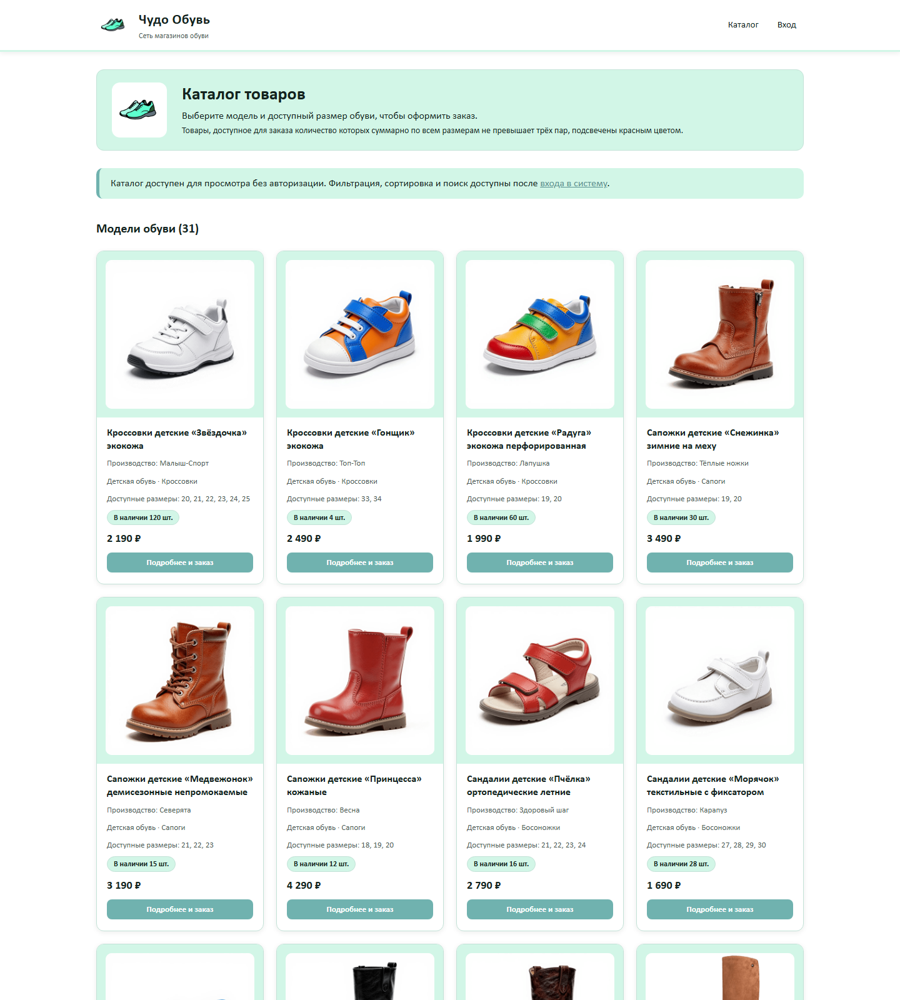
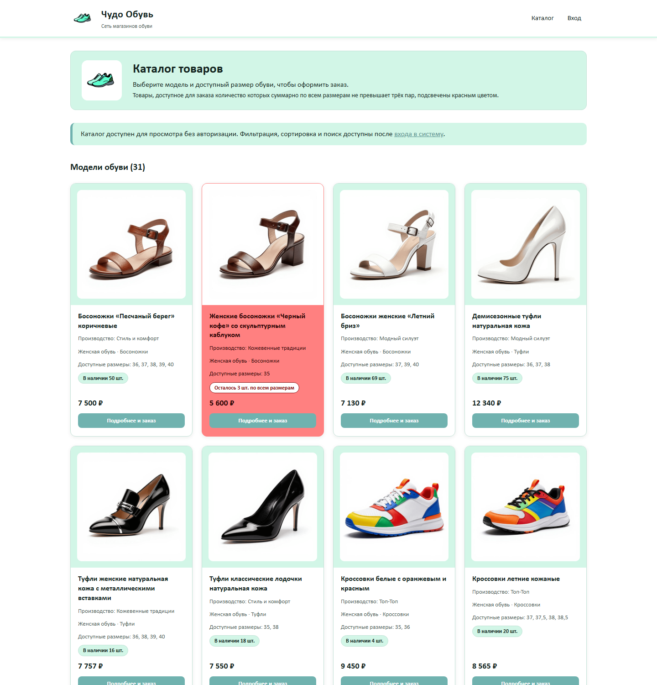
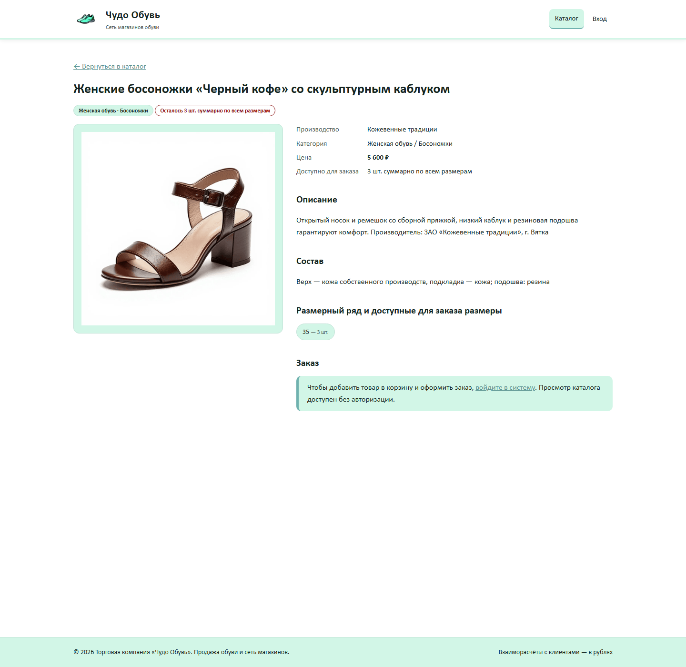
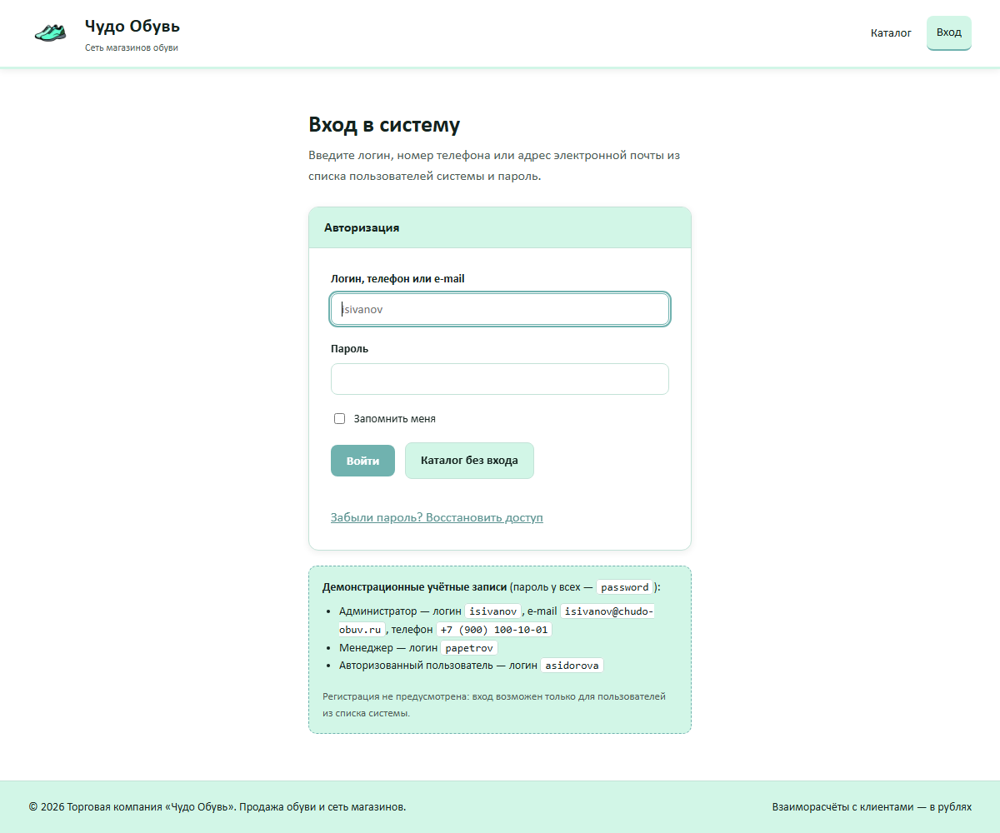
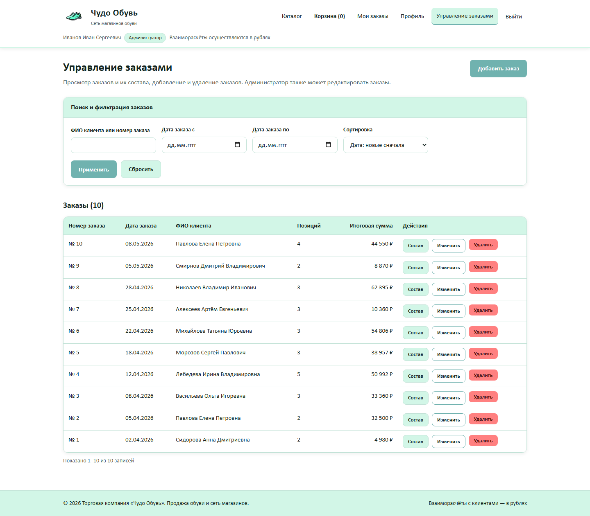
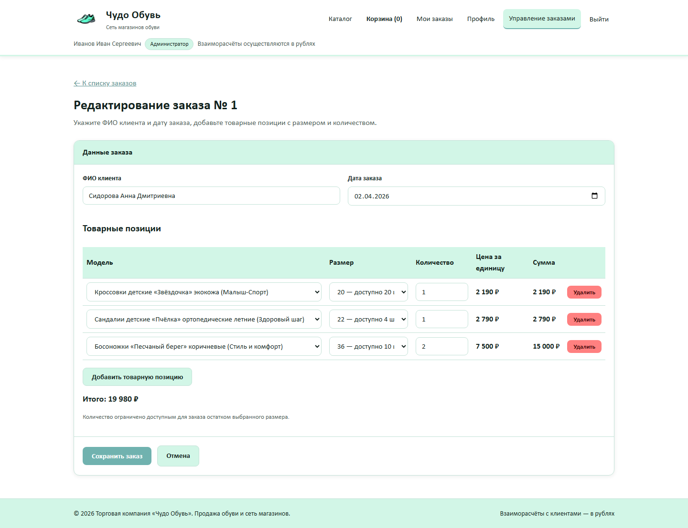
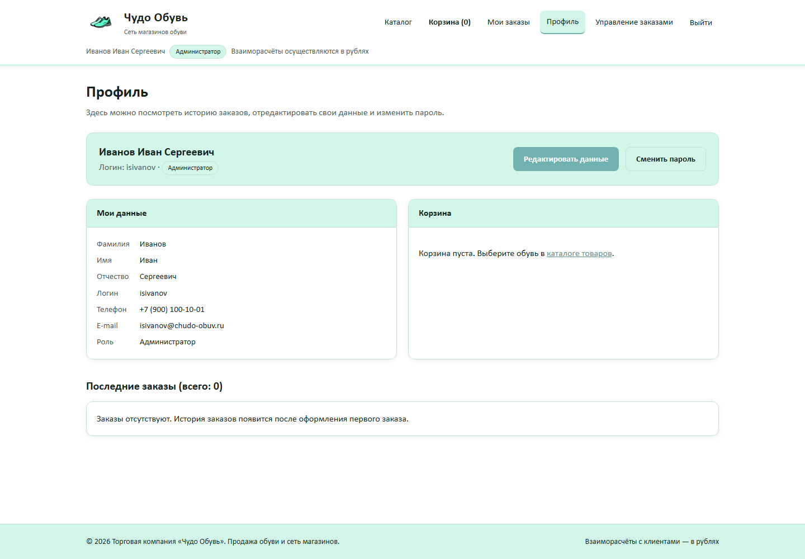

# Чудо Обувь — приложение для заказа обуви

**Репозиторий:** <https://github.com/Quartzglow/chudo-obuv-laravel>
· **Тесты:** 22/22 · **Laravel 13** · **PHP ≥ 8.3**

Учебный проект по заданиям 1 и 2 комплекта КИМ (специальность 09.02.07 «Информационные
системы и программирование»). Реализовано веб-приложение на **Laravel 13** (PHP ≥ 8.3)
для торговой компании «Чудо Обувь»: каталог обуви, корзина, оформление и управление
заказами, роли и профиль пользователя. Интерфейс оформлен по руководству по стилю
из задания 2.

## Что нужно для запуска

| Требование | Версия / примечание |
| --- | --- |
| PHP | 8.3 или новее, расширения `pdo_sqlite`, `sqlite3`, `mbstring`, `openssl`, `fileinfo`, `zip` |
| Composer | 2.x — <https://getcomposer.org/download/> |
| Node.js / npm | **не нужны**: CSS и JS лежат в `public/`, сборка Vite не используется |
| База данных | SQLite (файл создаётся автоматически, отдельный сервер БД не нужен) |

## Пошаговый запуск с нуля

### 1. Клонировать репозиторий

```bash
git clone https://github.com/Quartzglow/chudo-obuv-laravel.git
cd chudo-obuv-laravel
```

### 2. Установить PHP-зависимости

```bash
composer install
```

### 3. Создать файл окружения и ключ приложения

Windows (PowerShell):

```powershell
copy .env.example .env
php artisan key:generate
```

Linux / macOS:

```bash
cp .env.example .env
php artisan key:generate
```

### 4. Создать базу данных и импортировать данные из ресурсов

```bash
php artisan migrate:fresh --seed
```

Команда создаёт `database/database.sqlite`, применяет все миграции и запускает
`DatabaseSeeder`, который импортирует данные из `database/data/*.json` (31 модель,
35 размеров, 92 товарные позиции, 20 пользователей, 10 исторических заказов).

Если файла БД ещё нет и появилась ошибка «Database file does not exist»:

```bash
# Windows
type nul > database\database.sqlite
# Linux / macOS
touch database/database.sqlite
php artisan migrate:fresh --seed
```

### 5. Запустить приложение

```bash
php artisan serve
```

Откройте <http://127.0.0.1:8000>. Если порт 8000 занят:
`php artisan serve --port=8001`.

### Установка одной командой (необязательно)

Скрипты выполняют шаги 2–4 автоматически:

```powershell
# Windows
powershell -ExecutionPolicy Bypass -File scripts\setup.ps1
```

```bash
# Linux / macOS
bash scripts/setup.sh
```

После этого остаётся выполнить `php artisan serve`.

## Полезные команды Artisan

| Команда | Что делает |
| --- | --- |
| `php artisan migrate` | применить новые миграции |
| `php artisan migrate:fresh --seed` | пересоздать БД с нуля и импортировать данные из ресурсов |
| `php artisan db:seed` | повторно выполнить сидер (идемпотентен: обновляет/досоздаёт записи) |
| `php artisan db:seed --class=DatabaseSeeder` | явно запустить импорт ресурсов |
| `php artisan route:list` | список всех маршрутов приложения |
| `php artisan test` | прогнать тесты (22 теста) |
| `php artisan optimize:clear` | очистить кеши конфигурации, маршрутов и шаблонов |
| `php artisan serve` | запустить встроенный сервер разработки |

Сбросить данные к исходному состоянию из xlsx-ресурсов:

```bash
php artisan migrate:fresh --seed
```

## Частые проблемы

| Симптом | Решение |
| --- | --- |
| `No application encryption key has been specified` | `php artisan key:generate` |
| `could not find driver` / ошибка SQLite | включите расширения `pdo_sqlite` и `sqlite3` в `php.ini` |
| `Database file does not exist` | создайте `database/database.sqlite` (см. шаг 4) |
| `vendor/autoload.php` не найден | выполните `composer install` |
| `Class "..." not found` после обновления | `composer dump-autoload` |
| Ошибка 500, пустая страница | смотрите `storage/logs/laravel.log`, проверьте права на запись в `storage/` |
| Синтаксис PHP не поддерживается | нужен PHP ≥ 8.3 (`php -v`) |
| Порт уже занят | `php artisan serve --port=8001` |
| Стили не применились | очистите кеш шаблонов: `php artisan optimize:clear` |

## Учётные записи

Импортированы все 20 пользователей из `Users_import.xlsx`. Пароль у всех — `password`.
Войти можно по **логину**, **номеру телефона** или **адресу электронной почты**.
E-mail и телефон сформированы по шаблону: `логин@chudo-obuv.ru` и `+7 (900) XXX-XX-XX`.

| Роль | Логин | E-mail | Телефон |
| --- | --- | --- | --- |
| Администратор | `isivanov` | `isivanov@chudo-obuv.ru` | `+7 (900) 100-10-01` |
| Менеджер | `papetrov` | `papetrov@chudo-obuv.ru` | `+7 (900) 101-11-02` |
| Авторизованный пользователь | `asidorova` | `asidorova@chudo-obuv.ru` | `+7 (900) 102-12-03` |

Остальные логины и роли — в `database/data/users.json`.

## Возможности по ролям

| Возможность | Гость | Пользователь | Менеджер | Администратор |
| --- | :-: | :-: | :-: | :-: |
| Просмотр каталога | ✔ | ✔ | ✔ | ✔ |
| Фильтрация, сортировка, поиск | — | ✔ | ✔ | ✔ |
| Корзина: добавить/удалить позицию, изменить количество | — | ✔ | ✔ | ✔ |
| Оформление собственного заказа | — | ✔ | ✔ | ✔ |
| История своих заказов, редактирование данных, смена и восстановление пароля | — | ✔ | ✔ | ✔ |
| Просмотр всех заказов и состава конкретного заказа | — | — | ✔ | ✔ |
| Добавление нового заказа, удаление заказа | — | — | ✔ | ✔ |
| Редактирование заказа | — | — | — | ✔ |

Доступ к разделам ограничен middleware `role` (`app/Http/Middleware/EnsureUserHasRole.php`):
менеджер/администратор — префикс `/manage`, редактирование — только администратор.

## Данные из ресурсов

Исходные файлы (`Products_import.xlsx`, `Sizes_import.xlsx`, `Stock_Items_import.xlsx`,
`Orders_import.xlsx`, `Users_import.xlsx`, изображения, логотип, иконка) перенесены в проект:

- `database/data/*.json` — данные, полученные из xlsx (`_import.py` — воспроизводимый импорт,
  `_verify.py` — проверки);
- `public/images/products/` — 31 изображение моделей (имена файлов из ресурсов);
- `public/images/logo.png` — логотип (байт-в-байт из ресурсов, не перекодирован);
- `public/favicon.ico` — иконка приложения (из ресурсов);
- `public/images/picture.png` — дополнительное изображение из ресурсов.

Импорт выполняет `DatabaseSeeder`: категории/подкатегории, размеры, модели, товарные
позиции (модель + размер + доступное количество), пользователи, исторические заказы.

**Особенности исходных данных, учтённые при импорте:**

- в размерном ряду есть половинные размеры (36,5; 37,5; …) — размер хранится как `decimal(4,1)`;
- в `Stock_Items_import` и `Orders_import` три названия моделей записаны с отклонениями
  (хвостовой пробел, неразрывный пробел, уточняющий суффикс) — сопоставление выполняется
  по нормализованному названию, расхождения выводятся предупреждением при сидировании;
- исторические заказы не списывают остатки повторно (признак `orders.stock_applied`);
  их редактирование администратором также не меняет доступное количество, поскольку
  эти продажи уже учтены в текущем остатке. Заказы, созданные в приложении, списывают
  остаток и возвращают его при удалении;
- поиск по каталогу и по заказам не чувствителен к регистру, в том числе для кириллицы:
  SQLite `LIKE` регистронезависим только для латиницы, поэтому названия и ФИО
  дополнительно сохраняются в нижнем регистре (`products.search_text`,
  `orders.customer_search`) и поиск идёт по этим полям.

## Структура данных

- `users` — фамилия, имя, отчество, логин, телефон, e-mail, пароль, роль;
- `categories` — категория и подкатегория (`parent_id`);
- `products` — модель: категория, производство, описание, состав, цена, изображение;
- `sizes` — размерный ряд;
- `product_sizes` — товарная позиция: модель + размер + доступное для заказа количество;
- `orders` — дата заказа, ФИО клиента, итоговая сумма (в рублях);
- `order_items` — состав заказа: модель, размер, количество, цена за единицу.

## Руководство по стилю (задание 2)

- Заголовок (`<h1>` и `<title>`) есть на каждой экранной форме; шапка и подвал — на всех страницах.
- Логотип установлен на главной форме (блок-заставка каталога и шапка сайта). Пропорции
  сохранены: изображение выводится с фиксированной высотой и автоматической шириной,
  без перекодирования; сам файл — исходный PNG 1024×1024.
- Иконка приложения — исходный `Чудо Обувь.ico`, подключён как `favicon.ico`.
- Шрифт — **Calibri** (с резервным стеком `Segoe UI`, `Candara`).
- Цвета: основной фон `#FFFFFF`, дополнительный фон `#D2F6E7`, акцентирование целевых
  действий `#70B2AF`.
- В списке товаров модели, суммарный доступный остаток которых по всем размерам **≤ 3**,
  подсвечиваются цветом `#ff8080` (класс `.product-card.is-low-stock`).

## Тесты

```powershell
php artisan test
```

22 теста (176 проверок) покрывают: импорт ресурсов, каталог и гостевой доступ, подсветку
остатков, вход по трём идентификаторам, регистронезависимый поиск по кириллице, корзину,
оформление и списание остатков, ограничение количества, доступ по ролям, редактирование
и удаление заказов (включая неизменность остатков при правке исторического заказа),
профиль, смену и восстановление пароля, наличие заголовков на всех формах и соответствие
руководству по стилю.

## Скриншоты интерфейса

| Каталог | Подсветка остатка ≤ 3 |
| --- | --- |
|  |  |

| Карточка товара | Вход в систему |
| --- | --- |
|  |  |

| Управление заказами | Форма заказа |
| --- | --- |
|  |  |



## Восстановление пароля

Отправка почты в учебном проекте не настроена (`MAIL_MAILER=log`), поэтому после запроса
ссылка для сброса пароля выводится на странице `/password/forgot` (демонстрационный режим).
Ссылка действует 60 минут. Смена пароля авторизованным пользователем — в профиле.

## Основные маршруты

| Маршрут | Назначение |
| --- | --- |
| `/` , `/catalog` | каталог товаров (фильтры — для авторизованных) |
| `/catalog/{product}` | карточка модели, выбор размера и добавление в корзину |
| `/cart` | корзина |
| `/profile`, `/profile/edit`, `/profile/password`, `/profile/orders` | профиль, данные, пароль, история заказов |
| `/manage/orders…` | управление заказами (менеджер, администратор) |
| `/login`, `/password/forgot`, `/password/reset/{token}` | вход и восстановление пароля |

## Структура кода

```
app/
  Http/Controllers/        AuthController, CatalogController, CartController,
                           OrderController, ProfileController, PasswordResetController,
                           Manage/OrderController
  Http/Middleware/         EnsureUserHasRole
  Models/                  User, Category, Product, Size, ProductSize, Order, OrderItem
  Services/                Cart (корзина в сессии), OrderService (заказы и остатки)
  Support/                 Money (рубли), UserResolver (логин/телефон/e-mail)
database/
  data/                    JSON из ресурсов + скрипты импорта
  migrations/              схема БД
  seeders/DatabaseSeeder   импорт ресурсов
resources/views/           Blade-шаблоны (layout, каталог, корзина, заказы, профиль, auth, manage)
public/css/app.css         оформление по руководству по стилю
public/js/order-form.js    динамическая форма заказа
public/images/             логотип, изображения моделей, иконка
database/data/             JSON из ресурсов + скрипты импорта
docs/screenshots/          скриншоты интерфейса (используются в README)
scripts/setup.ps1|setup.sh установка одной командой (Windows / Linux, macOS)
docs/github-actions-tests.yml готовый воркфлоу для GitHub Actions
tests/Feature/ChudoObuvTest.php
```

## Непрерывная интеграция (по желанию)

В `docs/github-actions-tests.yml` лежит готовый воркфлоу: на каждый push и pull request
он устанавливает зависимости и запускает `php artisan test`. Чтобы включить CI:

```bash
mkdir -p .github/workflows
cp docs/github-actions-tests.yml .github/workflows/tests.yml
git add .github/workflows/tests.yml
git commit -m "ci: запуск тестов в GitHub Actions"
git push
```

Файл вынесен из `.github/`, потому что OAuth-токен `gh` без scope `workflow` не может
загружать воркфлоу. Если push отклонён с ошибкой про `workflow` scope:

```bash
gh auth refresh -s workflow
git push
```

Статус проверок после включения: <https://github.com/Quartzglow/chudo-obuv-laravel/actions>.